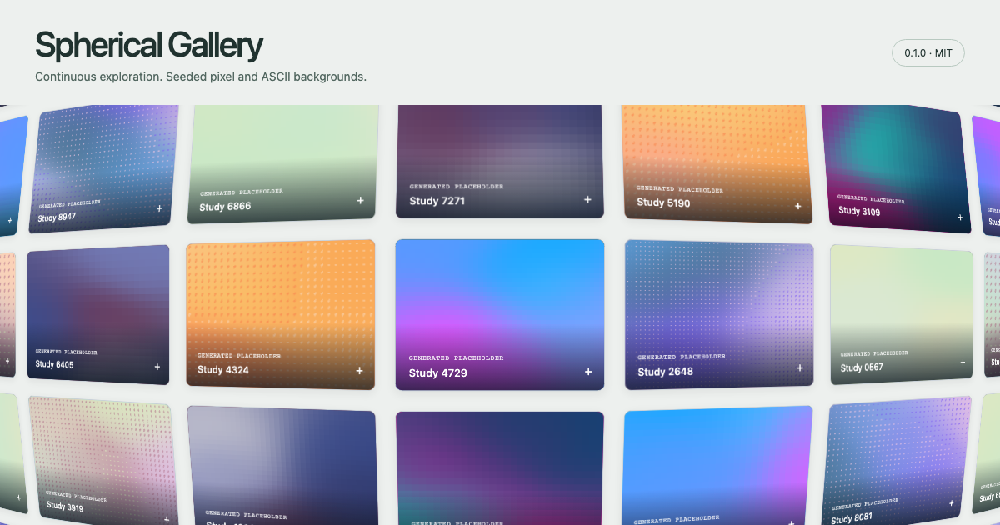

# Spherical Gallery

Two independently installable, MIT-licensed browser packages. Version **0.1.0**.



- **`@joelhoke/spherical-gallery`**: continuous spherical exploration, a real-item Grid, themed media, controls, and optional preview windows.
- **`@joelhoke/mesh-backgrounds`**: deterministic pixel/ASCII meshes, seven palettes, glyph bending, and ripples. No gallery dependency.

The runtime is plain TypeScript and DOM/Canvas. React wrappers and explicitly registered Web Components use the same runtime. Importing either package, including `/browser`, does not read browser globals or register elements. React is an optional peer dependency, loaded only by `/react`.

## Local development

```sh
npm ci
npm test
node scripts/build-demo.mjs
npm run dev
# Open http://127.0.0.1:4173
npx playwright install chromium firefox webkit
npm run test:browser
npm run pack:local
node scripts/verify-packed.mjs
```

The demo contains plain HTML, a second independently themed gallery, standalone backgrounds, all seven palettes, and a server-rendered React example with custom slots. Demo SVGs and the generated test clip are original, neutral MIT assets. The demo builds React locally; it uses no CDN.

## Install

```sh
npm install @joelhoke/spherical-gallery
# Optional, independent background package:
npm install @joelhoke/mesh-backgrounds
# React hosts also install their own react and react-dom.
```

For local development, substitute the two `.tgz` files produced in `artifacts/`.

The preview uses only generated placeholders, system fonts, and neutral styling. To regenerate it, start the demo server and run `node scripts/capture-preview.mjs`.

## Plain HTML and progressive enhancement

Keep usable links in the HTML so browsing works without JavaScript. Import the stylesheet in your page and set a container height. The controller restores the original fallback children on destruction.

```html
<link rel="stylesheet" href="/vendor/spherical-gallery/dist/styles.css" />
<spherical-gallery title="Work" style="--sg-height: 620px">
  <ul>
    <li><a href="/work/orbit">Orbit</a></li>
  </ul>
</spherical-gallery>
<script type="module">
  import { registerSphericalGallery } from '/vendor/spherical-gallery/dist/browser.js'
  const gallery = document.querySelector('spherical-gallery')
  // Properties may be assigned before registration or after upgrade.
  gallery.items = [
    {
      id: 'orbit',
      title: 'Orbit',
      category: 'Design',
      alt: 'A blue orbital sculpture',
      poster: { light: '/orbit-light.jpg', dark: '/orbit-dark.jpg' },
      destination: { kind: 'link', href: '/work/orbit' },
    },
  ]
  gallery.options = { theme: 'system' }
  registerSphericalGallery()
</script>
```

Copy the entire `dist` directory when serving native ESM: `/browser` is a browser-ready module entry, not a single self-contained bundle. A bundler can produce one file if needed. The default imports work with npm-aware bundlers.

## JavaScript

```js
import { createGallery } from '@joelhoke/spherical-gallery'
import { meshPlaceholder } from '@joelhoke/mesh-backgrounds/gallery' // optional
import '@joelhoke/spherical-gallery/styles.css'

const gallery = createGallery(container, {
  items,
  title: 'Work',
  theme: 'system',
  renderPlaceholder: meshPlaceholder({ renderer: 'ascii', palette: 'twilight' }),
  onPositionChange: (point) => console.log(point),
  // Optional sessionStorage persistence. Nothing is stored without this key.
  storageKey: 'my-collection-v1',
})
gallery.setView('grid')
gallery.restorePosition({ x: 240, y: 180 })
gallery.reset() // smooth return to (0, 0)
gallery.openPreview('orbit')
gallery.closePreview()
gallery.destroy()
```

See [API](docs/API.md), [styling and accessibility](docs/STYLING.md), [embedding](docs/EMBEDDING.md), and [extraction/release notes](docs/EXTRACTION.md).

## React and Next.js

```tsx
'use client'
import { SphericalGallery } from '@joelhoke/spherical-gallery/react'
import '@joelhoke/spherical-gallery/styles.css'

export function Work({ items }) {
  return <SphericalGallery items={items} title="Work" theme="system" />
}
```

The server and first client render are the same usable Grid. Enhancement starts in an effect, after hydration. No hydration-warning suppression is used. React slots are portals in the same React tree, so context remains available. In Next.js, define render callbacks/slots inside a Client Component; pass serializable item data across the server/client boundary. The `/react` entries retain `'use client'` in their compiled output.

```tsx
import { MeshBackground } from '@joelhoke/mesh-backgrounds/react'

;<SphericalGallery
  items={items}
  slots={{
    placeholder: ({ artwork, active, pointer }) => (
      <MeshBackground seed={artwork.seed} active={active} pointer={pointer} />
    ),
    card: ({ item }) => (
      <>
        
        <strong>{item.title}</strong>
      </>
    ),
    preview: ({ selection, close }) => <YourViewer selection={selection} onClose={close} />,
  }}
/>
```

Use a component ref for the same controller methods. Custom cards render **inside** the gallery's accessible link/button; do not nest another interactive trigger. Custom preview slots fill the stage inside the accessible dialog shell.

## Backgrounds alone

```js
import { createMeshBackground, registerMeshBackground, PALETTES } from '@joelhoke/mesh-backgrounds'
const mesh = createMeshBackground(hero, {
  seed: 104729,
  palette: 'neon-tide',
  renderer: 'ascii',
  glyphs: '.:+*=#@',
  font: 'ui-monospace, monospace',
  density: 36,
  interactive: true,
})
mesh.setActive(false) // retain pixels, particles, and animation phase
mesh.setActive(true)
mesh.destroy()
registerMeshBackground() // explicit; enables <mesh-background>
```

`<mesh-background seed="104729" palette="sunset" renderer="pixels">` and `<MeshBackground>` provide equivalent renderers. Give the element/container a height. An optional overlay is caller-owned DOM (`overlay`) or React children; no logos or fonts are bundled.

Copyright © 2026 Joel Hoke. [MIT](LICENSE).
