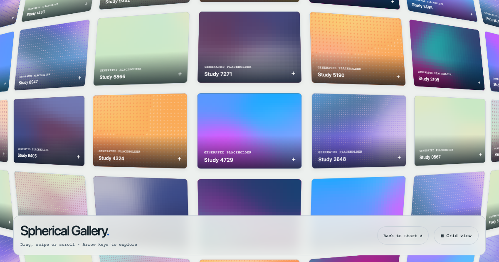

# @joelhoke/mesh-backgrounds

Framework-independent mesh backgrounds. MIT, copyright 2026 Joel Hoke.



```sh
npm install @joelhoke/mesh-backgrounds
```

ES modules, TypeScript declarations, explicit Web Component registration, and optional React wrappers. Import the default entry for JavaScript, `/browser` for native browser modules, `/react` for React, and `/styles.css` for scoped styles. Neither the default nor browser entry accesses browser globals at import time. React is an optional peer dependency.

Read the [repository documentation](https://github.com/joelhoke/spherical-gallery#readme) for installation, API, accessibility, styling, embedding, and cleanup. The gallery is optional; the background engine can run on any sized container.
